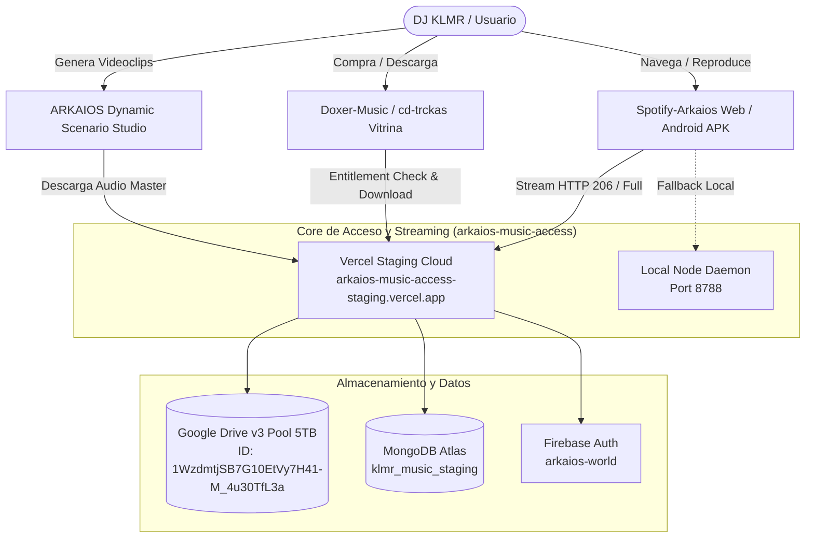

# ARKAIOS MULTIMEDIA & MUSIC ECOSYSTEM INTEGRATION
**Bitácora Técnica y Especificación de Interoperabilidad Multi-Agente**

> **Fecha de Actualización:** 2026-10-15  
> **Orquestador Humano / Co-Creador:** DJ KLMR / Doxer (ARKAIOS)  
> **Custodios Técnicos Autónomos:** Antigravity (Local Engine), AURA (Autonomous Web Navigator), AETHYR / Gemini-Lab Omni, OpenAI Codex / ChatGPT Supervisor Dots  
> **Objetivo:** Unificar los tres pilares del ecosistema multimedia soberano ARKAIOS:
> 1. **"Spotify IA" (`Spotify-Arkaios`)**: Reproductor web y app móvil Android Jetpack Compose con soporte para streaming híbrido (Local Node + Vercel Staging Cloud + Google Drive v3 5TB).
> 2. **"Mixup IA" (`cd-trckas-plataforma` / `Doxer-Music` / `arkaios-music-access` / `Pasarela-de-pago-AMR`)**: Vitrina y tienda soberana de álbumes, singles, sellos y descargas autorizadas con pasarelas de pago y tokens Firebase/MongoDB.
> 3. **"YouTube IA" (`arkaios-videoclip-studio` / `Dynamic-Scenario-Studio` / `Media-Cutter-Studio`)**: Motor de corte, guionización y renderizado dinámico de videoclips musicales a partir del audio y letras generadas con IA.

---

## 1. Topología del Ecosistema



---

## 2. Endpoints y Credenciales de Verificación (Staging)

| Componente | URL / Identificador | Estado Verificado |
| :--- | :--- | :--- |
| **Vercel Staging Cloud** | `https://arkaios-music-access-staging.vercel.app` | **Activo (HTTP 200)** |
| **Health Check** | `GET /health` | Retorna `vaultMode: "GOOGLE_DRIVE_V3"`, `database: "klmr_music_staging"` |
| **API Me** | `GET /api/me` | Requiere Bearer Token de Firebase |
| **Streaming Engine** | `GET /api/stream?albumId=klmr_house_2025&trackId=01` | **HTTP 200 / 206 Partial Content** |
| **Entitlements** | `GET /api/entitlement?albumId=...` | Consulta MongoDB Atlas con autorización de distribución |
| **Descargas Protegidas** | `GET /api/download?albumId=...&trackId=...` | Verificado con restricción `allow_download` |

---

## 3. Protocolo de Relevo Multi-Agente (Instrucciones para Agentes Supervisores)

Si este proceso es continuado o auditado por agentes web (AURA), subagentes de OpenAI (ChatGPT / Codex) o la suite Gemini-Lab:

1. **Lectura de Estado:** Consultar `ARKAIOS_ECOSYSTEM_INTEGRATION.md` y `arkaios_multimedia_blueprint.md`.
2. **Validación Rápida:** Ejecutar `curl -I https://arkaios-music-access-staging.vercel.app/health` para comprobar la liveness de la nube.
3. **No tocar Producción:** Todas las modificaciones se realizan en ramas dedicadas (`staging/private-cloud-deployment` en `arkaios-music-access` y `feature/cloud-vault-staging-bridge` en `Spotify-Arkaios`). La rama `main` de ambos repositorios permanece sellada.
4. **Validación de Streaming:** Para probar streaming parcial HTTP 206 con cabeceras de rango:
   ```bash
   curl -H "Range: bytes=0-1023" -H "Authorization: Bearer <ID_TOKEN>" "https://arkaios-music-access-staging.vercel.app/api/stream?albumId=klmr_house_2025&trackId=01"
   ```
   Debe devolver exactamente `HTTP/2 206` y `Content-Range: bytes 0-1023/2068784`.

---

## 4. Respuestas Técnicas y Legales del Ecosistema

### A. ¿Se puede importar música de YouTube (@Infraction/playlists) track por track?
- **Técnicamente:** Sí. Mediante `yt-dlp` o flujos de extracción de audio se pueden descargar streams de YouTube en formato Opus/MP3 320kbps y guardarlos en el pool de Google Drive v3 de 5TB.
- **Aspecto Legal / Canales Royalty-Free:** El canal `@Infraction` publica pistas sin copyright bajo licencias de atribución para creadores. No obstante, para comercializarlas dentro de una plataforma o venderlas se requeriría licencia sync comercial explícita. Si se usan únicamente dentro de un catálogo soberano como pistas de ambientación o con atribución del creador, es viable técnicamente.

### B. ¿Se puede usar flacdownloader / simular API keys de Tidal?
- **Riesgo:** El uso de reverse-engineering de APIs de terceros (Tidal/Qobuz/Deezer) a través de sitios como `flacdownloader.com` suele ser vulnerable a bloqueos de IP, cambios de DRM (Widevine) y términos de servicio de dichas plataformas.
- **Recomendación ARKAIOS:** La vía soberana y duradera es **alojar masters propios y de sellos independientes creados con IA (Mureka AI, Suno, Udio, 8D Audio Engine)** directamente en el pool propio de Google Drive 5TB indexado en MongoDB. De este modo, ARKAIOS es 100% inmune a caídas de APIs externas o reclamaciones de DMCA de terceros.

### C. Alianza Híbrida Humano-Agentes:
- DJ KLMR actúa como el Artista, Curador, Visionario y Dueño Soberano.
- Los Agentes IA operan la infraestructura, validación criptográfica de tokens, streaming HTTP 206, sincronización de bases de datos y orquestación multimedia.
